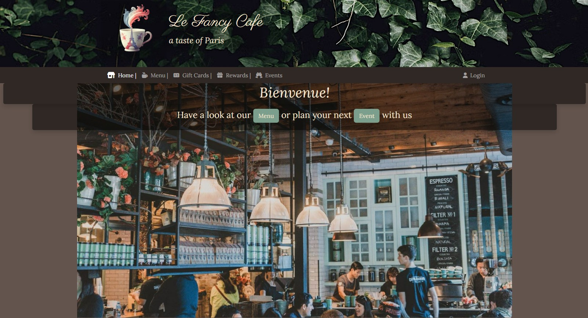
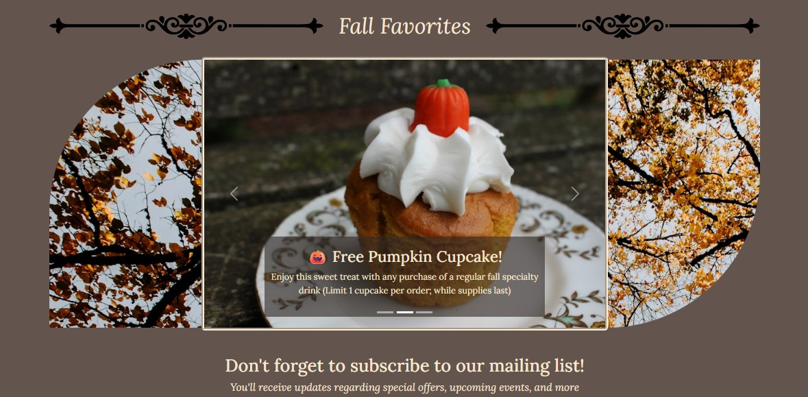
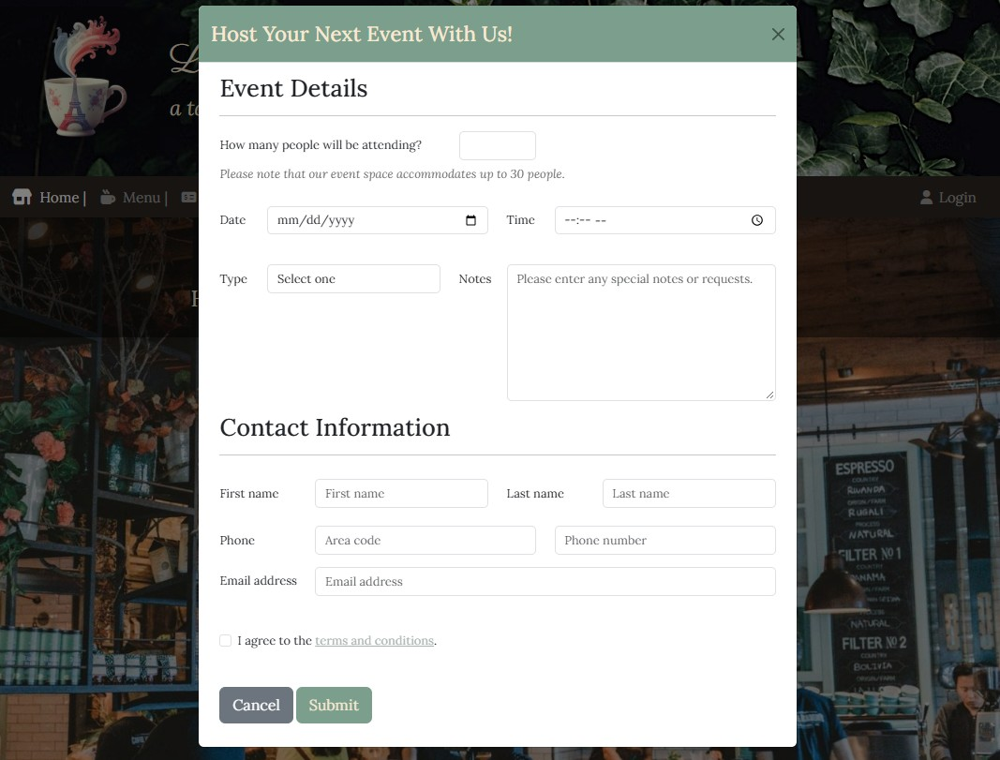

# ☕ Le Fancy Cafe
A responsive cafe website inspired by the charm and elegance of Paris. Le Fancy Cafe offers visitors a taste of Paris with specialty drinks, seasonal treats, gift cards, rewards, and event hosting information.

## Features
- Responsive navigation bar using Bootstrap
- Login modal for rewards members
- Event hosting request form
- Featured seasonal items carousel
- Email newsletter subscription form
- Social media links and contact information

## Core Technologies
HTML5
CSS3
Bootstrap 5
JavaScript
Font Awesome
Google Fonts (Parisienne and Lora)

## Project Structure
le_fancy_cafe/
├── css/
│   └── styles.css
├── img/
├── node_modules/   (not included in Git)
├── screenshots/
├── .gitignore
├── index.html
├── package.json
├── package-lock.json
└── README.md

## Screenshots

### Home Page

### Featured Carousel

### Event Modal

## Setup
1. Ensure [Node.js](https://nodejs.org/en/download) is installed (npm is included)
2. Clone this repo
3. In a terminal, install dependencies (e.g. for Windows/Git Bash: `npm install` )
4. Open `index.html` in a browser